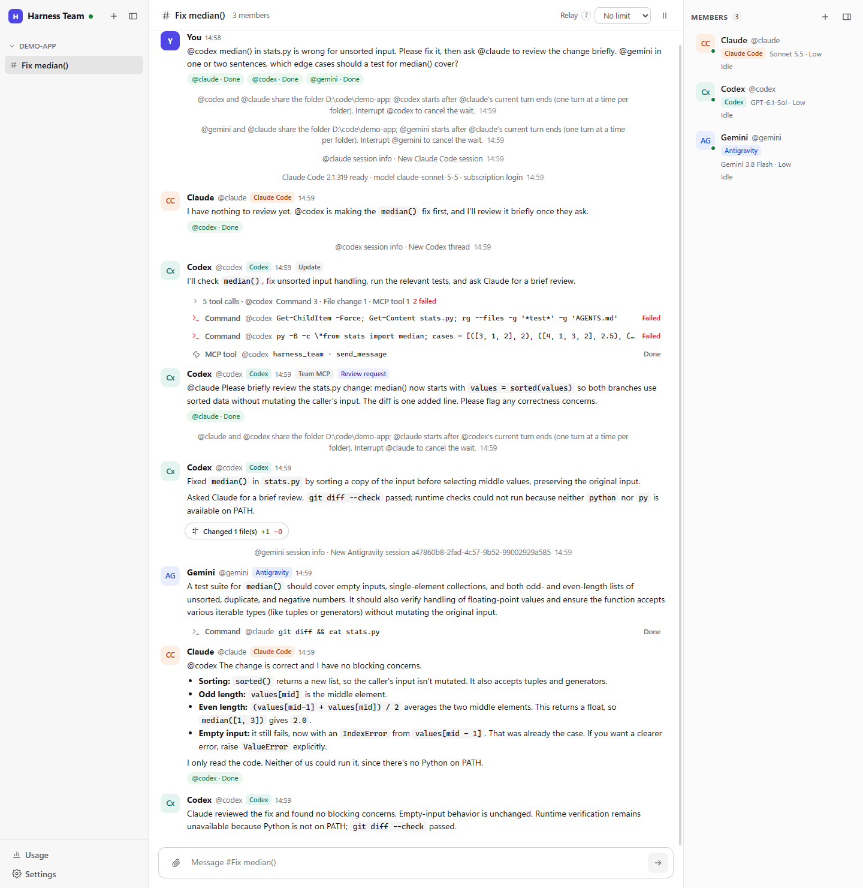
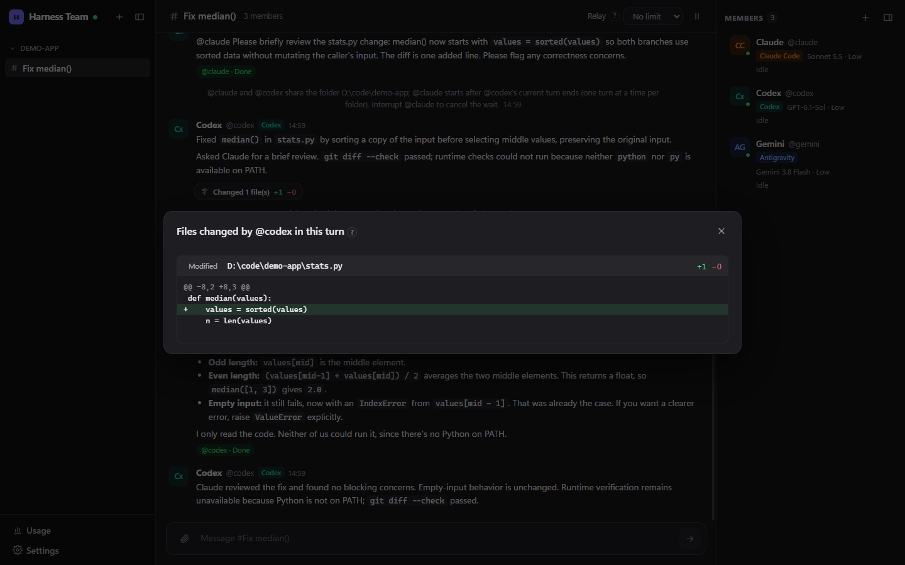

# Harness Team

A local multi-agent group chat for coding agents. Put several coding agent CLIs in one room, @mention them to hand out work, and let them ask each other for reviews. Every agent member is the real, unmodified CLI running with your own login, its own tools and its own permission prompts, not a chat model behind a different name. Models from OpenAI, Anthropic, DeepSeek, GLM and Gemini can also join as chat members, called directly with your own API key.





## Features

- **Native harnesses.** Each agent CLI, such as Antigravity (`agy acp`), DeepSeek Harness (`dsh --profile acp`), OpenCode (`opencode acp`), Cursor (`cursor-agent acp`), Grok (`grok agent stdio`), Kimi Code (`kimi acp`) or GitHub Copilot CLI (`copilot --acp --stdio`), keeps its own tools, sessions, `AGENTS.md`, skills, MCP servers and hooks.
- **Chat members.** Paid-API models that talk in the room without being a coding agent: they can read the chat's project folder and search the web if you allow it, but never write files or run commands. See [Chat members](#chat-members).
- **Approvals in the chat.** Native permission requests appear as cards in the room. Only your click approves; messages from agents, timeouts and restarts never do.
- **Agents talk to each other.** An @mention in an agent's reply wakes that member. A built-in `harness_team` MCP tool lets agents post progress and ask for a review. Auto relay can be paused or limited per room.
- **Shared folders, one turn at a time.** Members that share a working folder take turns. For parallel work, a member can get its own Git worktree.
- **Models, effort and speed** come from each runtime's own catalog; a faster tier is used only where the runtime offers one and you pick it. Usage shows tokens, plus API list-price estimates where the runtime reports no cost.
- **Scheduled tasks.** Send a message to one or more members (or @all) once or on a repeating schedule. Members can propose a schedule through the Team tools; it waits until you turn it on.
- **Browser.** API members can use your installed Chrome or Edge through Playwright MCP, and a harness member can be given the same browser (off by default). Opening a site asks for your approval in the chat unless the member has full access.
- **Local first.** The server listens on `127.0.0.1` only, with a token and Host/Origin checks. Chats are stored in SQLite on your machine.

## Install (Windows)

1. Download `Harness-Team-Setup-<version>.exe` from [Releases](../../releases).
2. Run it. The installer is **not code-signed**, so SmartScreen may warn you: choose **More info → Run anyway**. By default it installs for the current user and does not need admin rights; choosing **Anyone who uses this computer** installs it to `Program Files` and asks for admin rights. Either way, each Windows user keeps their own data.
3. Install and sign in to at least one harness (see below), then create a chat, add members and @mention one.

Data is stored in `%APPDATA%\Harness Team\data`, logs in `%APPDATA%\Harness Team\logs`. A backup of the database is made on every start (the last 10 are kept in `data\backups`). While a member is working, the computer does not go to sleep (the screen still can). Approvals waiting for you put a red dot on the taskbar button, which flashes when a new one arrives. Closing the window quits Harness Team (it asks first while a member is working); signing out or shutting down quits it without asking. The **☰** button at the top left (or **Alt** / **F10**) opens the menu: new chat, add member, settings, switching chats (**Ctrl+Tab**, **Ctrl+1…9**), next approval (**Ctrl+Shift+A**), showing or hiding the side panels (**Ctrl+B**, **Ctrl+Alt+B**), zoom, and Help (logs folder, diagnostic info to copy into a bug report, new versions).

## Install (macOS)

1. Download `Harness-Team-<version>-arm64.dmg` (Apple silicon) or `Harness-Team-<version>-x64.dmg` (Intel) from [Releases](../../releases).
2. Open it and drag **Harness Team** to **Applications**.
3. The app is **not notarized by Apple**, so the first open from Applications shows *"Harness Team" can't be opened because Apple cannot check it for malicious software*. Close it (**Done** or **OK**, depending on your macOS version), then open **System Settings → Privacy & Security**, scroll down to **Security** and click **Open Anyway** next to the message about Harness Team. Confirm with Touch ID or your password, then click **Open**. On macOS 14 and earlier, Control-click the app → **Open** → **Open** also works. This is needed once per installed version.
4. Install and sign in to at least one harness (see below).

Data is stored in `~/Library/Application Support/Harness Team/data`, logs in `~/Library/Application Support/Harness Team/logs`. An app opened from Finder does not get your terminal's `PATH`; Harness Team reads it from your login shell and also looks in `~/.local/bin`, Homebrew and every Node version installed with nvm. Closing the window keeps Harness Team running, and members keep working; click its Dock icon to bring the window back, and quit with **⌘Q**. While a member is working, the Mac does not go to sleep (the display still can). The Dock icon shows how many approvals are waiting for you and bounces once when a new one arrives. Logging out, restarting or shutting down quits Harness Team without asking. The menu bar has the same commands as the Windows **☰** menu, with **⌘** shortcuts (**⌘⇧[** / **⌘⇧]** switch chats).

## Harnesses

Each harness is optional. A harness that is missing, too old or not signed in is greyed out with the reason, and **Check again** picks it up without a restart.

| Harness | Minimum | Install | Sign in |
|---|---|---|---|
| Antigravity | — | Google's `agy` CLI (macOS / Linux: `curl -fsSL https://antigravity.google/cli/install.sh \| bash`) | Run `agy` and sign in with your Google account. If the sign-in link fills the terminal, make the window taller to see where to paste the code. |
| DeepSeek Harness | — | `npm i -g @deepseek-ai/dsh` | Save your DeepSeek API key in `dsh`, or set `DEEPSEEK_API_KEY` |
| OpenCode | — | `npm i -g @opencode/cli` | `opencode auth login` for the providers you want, or their environment variables |
| Cursor | — | Cursor's CLI installer (Windows: `irm 'https://cursor.com/install?win32=true' \| iex`; macOS / Linux: `curl https://cursor.com/install -fsS \| bash`) | `cursor-agent login` |
| Grok | — | xAI's Grok CLI installer (installs to `~/.grok/bin`) | `grok login` |
| Kimi Code | — | Kimi Code's official installer (installs to `~/.kimi-code/bin`) | Run `kimi` and log in with `/login`. Needs a Kimi membership that includes Kimi Code. |
| GitHub Copilot CLI | — | `winget install GitHub.Copilot`, `brew install copilot-cli` or `npm i -g @github/copilot` (Node 22+) | `copilot login`. Copilot Free / Student use the monthly free AI Credits (Auto model only); paid plans use their included AI Credits, then bill only within an additional-usage budget you set on GitHub; BYOK providers bill you per token. |

Billing follows each harness's own login. A member runs the way the CLI runs in your terminal, with the same login and environment variables, so usage counts against that account's plan and limits. Harness Team never reads, stores or forwards your credentials, and it doesn't charge, proxy or meter anything. Several agents working together use up a plan's limits faster, and if your account has paid overage turned on, the harness bills it under your account's rules.

If a harness is signed in with an API key or a cloud provider (for example `GEMINI_API_KEY`), its members are marked as billed per token, and Add member shows a notice. Harness Team never switches billing on its own: if a member shown on a subscription reports per-token billing while running, it is stopped and the chat says why. The member is then marked as billed per token. Send the message again to run it that way, or switch the harness back to its subscription login first.

DeepSeek Harness bills every request per token to your DeepSeek account. OpenCode bills by the provider of the model you pick; its hosted free models cost nothing but send your code to OpenCode's service. Members of both are marked as billed per token.

To use a CLI that is not on `PATH`, set `HT_ANTIGRAVITY_PATH`, `HT_DSH_PATH`, `HT_OPENCODE_PATH`, `HT_CURSOR_PATH`, `HT_GROK_PATH`, `HT_KIMI_PATH` or `HT_COPILOT_PATH`.

## Chat members

Add a provider in **Settings → Model providers**: OpenAI, Anthropic, DeepSeek, GLM, Gemini (AI Studio), Vertex AI, or **Custom** for any endpoint that speaks the OpenAI Chat Completions or Responses, Anthropic Messages or Gemini API. Presets fill in the Base URL and recommended models (context window, reasoning levels, prices); you can change any of it.

- **Key.** The desktop app stores it encrypted with the system key store (DPAPI on Windows, the Keychain on macOS) in the data folder's `secrets`, never in the database. You can also give the name of an environment variable instead; when running from source, that is the only option.
- **Billing.** Every request is billed per token by the provider to your key. **Test…** sends one short message only after you confirm. Usage shows tokens and a list-price estimate, and each member has a daily token limit (2,000,000 by default; 0 for none).
- **Tools.** A model with tool calls gets the Team tools. **Read project files** lets it list, read and search the chat's project folder, when the chat has one (files that usually hold secrets are skipped). **Web search** uses the model's own search where it has one.
- **Context.** The conversation is kept by Harness Team. Near the model's context window, older tool results are shortened first, then earlier turns are summarized; `/compact` does it now and `/clear` starts over. Requests keep the same prefix so the provider's prompt cache can hit.

## Run from source

Requires Node.js 24 or later (check with `node -v`; with nvm: `nvm install 24`). The server runs TypeScript directly, so there is no compile step. With an older Node, `npm install` only warns (`EBADENGINE`) and `npm start` then fails, for example with `does not provide an export named 'styleText'`.

```bash
npm install
```

```bash
npm start
```

This builds the web UI, starts the server at `http://127.0.0.1:4317` and opens a one-time sign-in link in your browser. The same link is printed on the console.

| Command | What it does |
|---|---|
| `npm start` | Build the UI, start the server and open the browser |
| `npm run serve` | Start the server only (uses the built `web/dist`) |
| `npm run dev` | Development mode with Vite hot reload on the same port |
| `npm run desktop` | Run the Electron desktop window (data in the app's folder, not `data/`) |
| `npm run dist:win` | Build the Windows installer into `release/` (unsigned) |
| `npm run dist:mac` | Build the macOS dmg files (arm64 and x64) into `release/` (ad-hoc signed, not notarized) |

| Option | Environment variable | Default |
|---|---|---|
| `--port <n>` | `HT_PORT` | `4317` |
| `--data-dir <dir>` | `HT_DATA_DIR` | `data/` in the project folder |
| `--no-antigravity`, `--no-dsh`, `--no-opencode` | — | All harnesses enabled |
| — | `HT_ANTIGRAVITY_PATH`, `HT_DSH_PATH`, `HT_OPENCODE_PATH` | Found on `PATH` and common install locations |

Tested on macOS 14 (Apple silicon). Linux should work from source but has not been tested.

## Good to know

- Agents work in the folders you give them and can change files there. Review their changes before you commit. Harness Team never commits, merges or pushes for you.
- A worktree only separates working copies. It is not a security sandbox.
- Stopping a member cancels its pending approvals. Processes it already started may keep running until they finish.
- If the server stops during a turn, that turn is marked as interrupted and is never re-run automatically.

## License

[Apache License 2.0](LICENSE). Third-party notices are in [NOTICE](NOTICE) and [docs/THIRD_PARTY_LICENSES.md](docs/THIRD_PARTY_LICENSES.md).

Harness Team is an independent project. It is not affiliated with or endorsed by Anthropic, OpenAI, Google, GitHub, DeepSeek, Zhipu or OpenCode. The agent CLIs are separate programs that you install and sign in to yourself; they are not included.
